<p align="center">
  
</p>

# vanTilburg Cards

Compact Home Assistant cards for room temperatures, lights, household storage, waste collection and energy use. Shared pastel palettes preserve a calm overview in light and dark themes. Each card can open a Bubble Card popup made of reusable **sections + cards**.

[](https://github.com/thomasvt1/vantilburg-cards/actions/workflows/ci.yml) [](https://github.com/thomasvt1/vantilburg-cards/actions/workflows/hacs.yml) [](https://github.com/thomasvt1/vantilburg-cards/releases/latest)

[](https://my.home-assistant.io/redirect/hacs_repository/?owner=thomasvt1&repository=vantilburg-cards&category=plugin)

## Cards

| Card | Custom element | Content |
| --- | --- | --- |
| Room | `custom:home-room-card` | Temperature from a climate entity/sensor, or a count of lights on. |
| House | `custom:home-house-card` | One to six named percentage sensors and compact progress bars. |
| Waste collection | `custom:home-waste-card` | Days until collection, waste type and an optional bin-out flag. |
| Energy group | `custom:home-energy-card` | Combined power of a group of devices, its share of home use and each device's draw, or the home use not metered by plugs. |
| Power | `custom:home-power-card` | One power or percentage reading, such as home use, solar, grid or battery, with an optional second value. |

No backend integration is required. These cards read existing entity states. A popup's child cards retain their own actions and dependencies.

All five cards have a visual configuration editor, card-picker preview, YAML configuration, and Sections/Masonry sizing. Every card can open a Bubble Card popup with repeated **section + content** groups. The visual editor configures both the popup and its child cards.

<!-- BEGIN GENERATED EXAMPLES -->
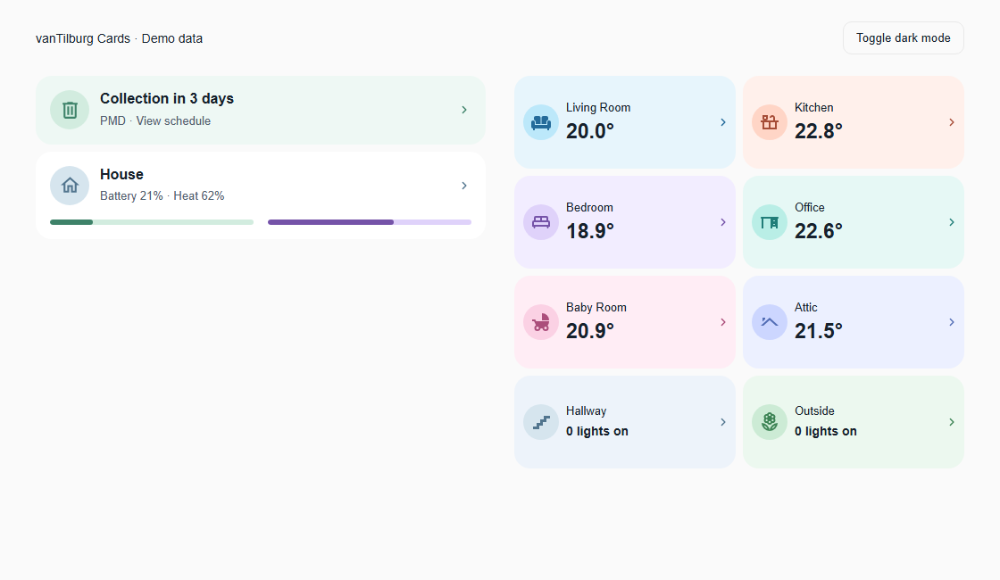

Full dashboards: [desktop dark](examples/desktop-dark.png) · [phone light](examples/mobile-light.png) · [phone dark](examples/mobile-dark.png)

### Card previews

Synthetic readings only. Regenerate these images with `npm run update:examples`.

| Card | Light theme | Dark theme |
| --- | --- | --- |
| Room | 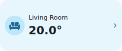 | 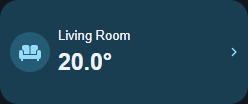 |
| House | 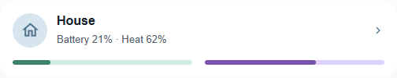 | 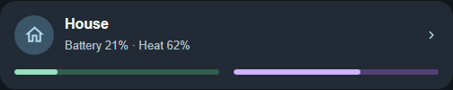 |
| Waste collection | 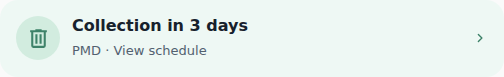 |  |
| Energy group | 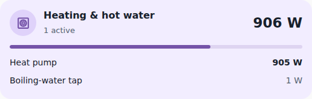 | 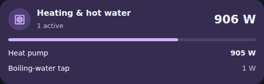 |
| Power | 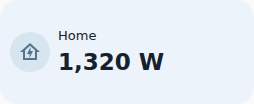 | 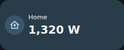 |
| Sectioned popup | 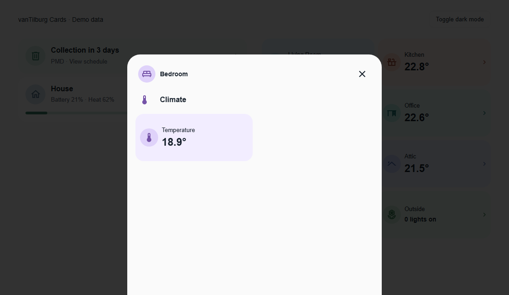 | 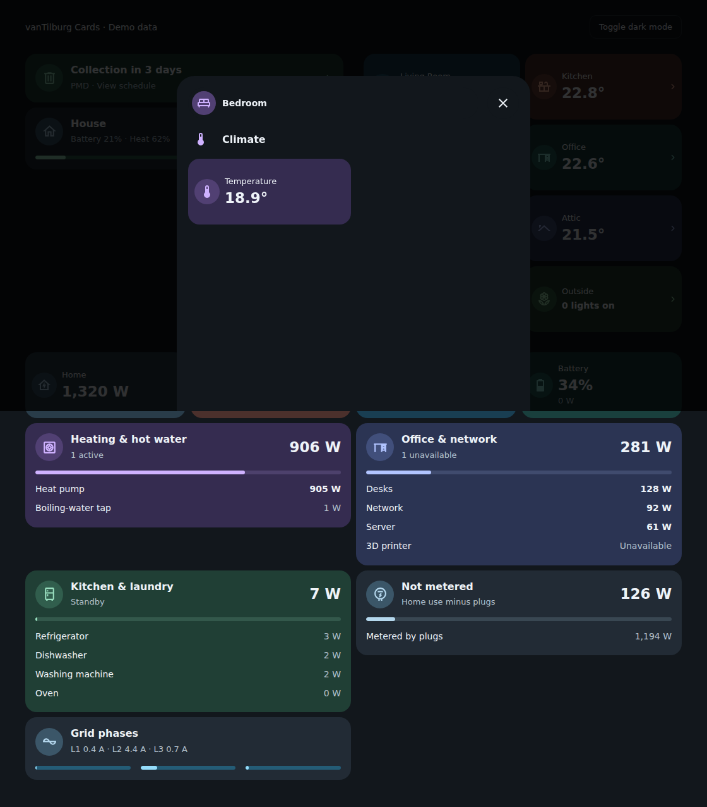 |
| Editor popup preview | 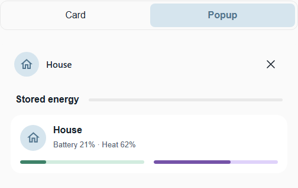 | 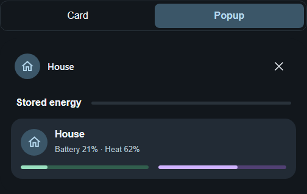 |

Phone previews: Room ([light](examples/room-mobile-light.png), [dark](examples/room-mobile-dark.png)) · House ([light](examples/house-mobile-light.png), [dark](examples/house-mobile-dark.png)) · Waste collection ([light](examples/waste-mobile-light.png), [dark](examples/waste-mobile-dark.png)) · Energy group ([light](examples/energy-mobile-light.png), [dark](examples/energy-mobile-dark.png)) · Power ([light](examples/power-mobile-light.png), [dark](examples/power-mobile-dark.png)) · Popup ([light](examples/popup-mobile-light.png), [dark](examples/popup-mobile-dark.png)) · Editor preview ([light](examples/editor-mobile-light.png), [dark](examples/editor-mobile-dark.png))
<!-- END GENERATED EXAMPLES -->

## Requirements

- Home Assistant 2026.10 or newer, matching the package's declared HACS minimum.
- Existing temperature, light, percentage or collection-day entities, selected in the editor.
- [Bubble Card 3.4.3 or newer](https://github.com/Clooos/Bubble-Card) installed through HACS and loaded as a dashboard resource when using popups. Summary cards work without it.
- Any custom cards used inside a popup installed separately. Native child cards need no additional card library.

## Install through HACS

vanTilburg Cards is available as a **custom repository**; it is not currently included in the HACS default catalog.

1. Use the **Add to HACS** button above, or open **HACS → Custom repositories**.
2. Add `https://github.com/thomasvt1/vantilburg-cards` with type **Dashboard**.
3. Find **vanTilburg Cards** and download the latest release.
4. Reload your browser, then search for **vanTilburg** in **Add card** on your dashboard.

[Open this repository in HACS](https://my.home-assistant.io/redirect/hacs_repository/?owner=thomasvt1&repository=vantilburg-cards&category=plugin)

HACS normally registers the module automatically. If your resources are managed manually, add `/hacsfiles/vantilburg-cards/vantilburg-cards.js` as a **JavaScript Module**, with a version query when updating. Avoid duplicate manual and HACS resources.

## Install manually

1. Download `vantilburg-cards.js` from the [latest release](https://github.com/thomasvt1/vantilburg-cards/releases/latest), or build it with `npm ci` and `npm run build`.
2. Copy the asset to `/config/www/vantilburg-cards.js` on Home Assistant.
3. Add a dashboard resource with URL `/local/vantilburg-cards.js?v=0.4.2` and resource type **JavaScript Module**.
4. Reload the browser. In **Add card**, search for **vanTilburg**.

For dashboards with YAML-managed resources:

```yaml
resources:
  - url: /local/vantilburg-cards.js?v=0.4.2
    type: module
```

The bundle contains Lit, the summary cards, the Bubble popup adapter and the editors. Bubble Card is installed separately; it is not bundled or downloaded by this library. Change the URL version when replacing the asset to avoid a stale browser cache.

### HACS packaging

`hacs.json` declares `vantilburg-cards.js` as the release asset. Tagged releases run HACS validation and the included checks before attaching the self-contained bundle and dependency notices to the GitHub release.

## Configuration

All cards appear in the card picker. Visual editors configure entities, labels, palettes, meters, devices, navigation and appearance. Under **On tap**, enable a popup and set its title, icon and unique link. Add, remove or reorder sections and choose one or two columns. Each section embeds Home Assistant's native stack/card editor to add, edit, reorder and remove child cards. Child cards without a visual editor use HA's normal YAML fallback. Advanced `type_names` mappings remain available through YAML.

### Preview while editing

With a popup enabled, use **Card / Popup** above the card preview to switch between the summary and the complete popup. Popup renders inline so the editor stays usable. Titles, sections, columns, child cards and colors reflect the current unsaved draft; you do not need to save or exit the editor. The selected mode survives Home Assistant rebuilding the preview after edits.

Preview child controls are inactive, and previewing does not navigate or change device state. Use the saved dashboard popup to operate devices. The toggle is editor-only and is never stored in dashboard YAML. On smaller screens, scroll to Home Assistant's preview area below the editor.

| Option | Applies to | Default | Purpose |
| --- | --- | --- | --- |
| `type` | All | Required | One of the custom element names above. |
| `name` | All | Card default | Room/house label or waste countdown title override. |
| `icon` | All | Card default | Home Assistant icon name. |
| `palette` | All | Card default | One of the ten named light/dark palettes. |
| `language` | All | `auto` | Follow HA, or choose `en` or `nl`. |
| `entity` | Room, waste, power | Required for temperature/countdown/power | Temperature, days-until-collection or tile reading source. |
| `display` | Room | `auto` | `auto`, `temperature` or `lights`. |
| `attribute` | Room | Climate current temperature or sensor state | Explicit temperature attribute. |
| `precision` | Room, power | `1` (room), `0` (power) | Decimal places, from 0 to 3. Power readings in W/kW ignore it. |
| `lights` | Room | None | Light entity IDs to count. |
| `meters` | House | Required | One to six sensors, each with `entity`, `name`, optional `palette` and optional `max` for non-percentage readings. |
| `type_entity` | Waste | None | Waste type sensor. |
| `moved_entity` | Waste | None | Bin-out boolean entity. |
| `type_names` | Waste | English/Dutch defaults | YAML mapping from lowercase waste states to labels. |
| `devices` | Energy group | Required | 1 to 30 power sensors, each with `entity` and optional `name`. |
| `home_entity` | Energy group | None | Home consumption sensor; adds the share-of-home-use bar. |
| `remainder` | Energy group | `false` | Show home use minus all `devices` instead of the device list. Requires `home_entity`. |
| `idle_threshold` | Energy group | `5` | Devices below this many watts count as idle and are shown muted. |
| `secondary_entity` | Power | None | Second reading shown below the main value. |
| `popup` | All | None | Popup link, heading and ordered sections. |
| `tap_action` | All | `none` | Navigation or sensor details when no popup is configured. |
| `appearance` | All | Palette/theme defaults | Optional colors and corner radius. |

See [examples/dashboard.yaml](examples/dashboard.yaml) for a complete Sections dashboard using every card. Examples use generic identifiers; select your own entities before adding them.

### Room and popup

```yaml
type: custom:home-room-card
name: Bedroom
icon: mdi:bed-king-outline
entity: climate.bedroom
palette: purple
popup:
  hash: '#bedroom'
  sections:
    - title: Lights
      icon: mdi:lightbulb-outline
      cards:
        - type: tile
          entity: light.bedroom
          features:
            - type: light-brightness
    - title: Climate
      icon: mdi:thermometer
      cards:
        - type: tile
          entity: climate.bedroom
          features:
            - type: target-temperature
        - type: custom:quatt-chill-card
          layout: slim
```

The popup inherits the card's palette. Its optional `title` and `icon` override the header. Each section takes an optional `title`, `icon`, `columns` (1 or 2), and a `cards` list using ordinary Lovelace configuration. Sections become native Bubble separators and ordinary Lovelace cards or grids. Every popup requires Bubble Card, including popups with only native children. Quatt, OmniBattery and other custom child cards must also be installed separately.

Bubble children without an explicit `styles` field receive a shared palette and on/off styling preset, including children inside grids/stacks. This removes repeated per-room CSS. A child's explicit `styles` bypasses the preset. The adapter uses Bubble's styling hooks and should be rechecked when updating Bubble Card.

Use a **unique hash per popup within a view**. The library opens the hash using Home Assistant navigation; Bubble Card owns the popup container, animation, scrolling, backdrop, swipe-to-close, Escape, close button and history handling. The adapter uses Bubble's public standalone `cards` configuration, with a 560px desktop width and the original 64px desktop / 56px mobile top offsets. It does not copy or patch Bubble's popup implementation. Nested popup definitions are not supported.

The editor's inline preview remains a noninteractive content preview so you can edit unsaved drafts without opening a live popup. Test animations and gestures on the saved dashboard. If Bubble is missing, tapping a summary shows an installation message rather than opening a different popup implementation.

An embedded popup replaces `tap_action`. To retain an existing external popup instead, omit `popup` and configure:

```yaml
tap_action:
  action: navigate
  navigation_path: '#existing-popup'
```

Supported actions are `none`, `navigate` (local path/hash), and `more-info` (optional `entity`). Household/device actions belong in popup child cards. A house card needs an explicit entity for `more-info`.

On a card without a popup or tap action, each reading opens its own sensor's details and history: a room temperature, each house meter, both power tile readings and each device row in an Energy group. A computed value, such as a group total, a light count or the unmetered remainder, is not a single sensor and stays plain text. A card with a popup or tap action keeps one action for the whole card, and the editor preview is never interactive.

Room options: `entity`, optional `attribute` (defaults to `current_temperature` for climate entities and state for sensors), `precision` (0–3, default 1), `display` (`auto`, `temperature`, `lights`), and `lights` (entity list). Auto shows temperature when an entity is configured; otherwise it counts lights. Missing sensors show **Unavailable**; missing lights are not counted as off. Celsius uses the compact ° suffix; Fahrenheit remains °F.

```yaml
type: custom:home-room-card
name: Hallway
icon: mdi:stairs
palette: slate
display: lights
lights:
  - light.hallway
  - light.landing
```

### House summary

```yaml
type: custom:home-house-card
name: House
meters:
  - entity: sensor.battery_percentage
    name: Battery
    palette: mint
  - entity: sensor.heat_storage_percentage
    name: Heat
    palette: purple
```

Sensors must report percentages from 0 to 100. Zero is valid; unavailable, nonnumeric and out-of-range values show an em dash and an empty unavailable track. Meter labels remain visible alongside the bars.

Give a meter a `max` to show any other reading against a full scale, such as the current on each grid phase against its fuse. The summary shows the value with its unit and sign, and the bar fills to `max` by magnitude, so a phase exporting solar power at −4 A shows the same bar as one drawing 4 A. Readings beyond `max` show a full bar.

```yaml
type: custom:home-house-card
name: Grid phases
icon: mdi:current-ac
meters:
  - entity: sensor.phase_1_current
    name: L1
    max: 25
    palette: blue
  - entity: sensor.phase_2_current
    name: L2
    max: 25
    palette: blue
  - entity: sensor.phase_3_current
    name: L3
    max: 25
    palette: blue
```

### Energy group

```yaml
type: custom:home-energy-card
name: Office & network
icon: mdi:desk
palette: indigo
home_entity: sensor.home_power
devices:
  - entity: sensor.desks_power
    name: Desks
  - entity: sensor.network_power
    name: Network
  - entity: sensor.printer_power
```

The card adds up the available devices and lists them by current draw, largest first. Devices below `idle_threshold` (default 5 W) are shown muted, and the subtitle reports how many are active, `Standby` when none are, or how many are unavailable. Unavailable devices stay listed as **Unavailable** and are never counted as zero. A device without `name` uses its friendly name. With `home_entity`, a bar shows the group's share of home use.

Sensors must report power in W, kW or MW; kWh energy totals are rejected as unavailable. Readings of 10 kW and more are shown in kW.

Set `remainder: true` to show the home use your plugs do not measure: `home_entity` minus the sum of `devices`. List every metered plug as a device. The card then shows the metered total instead of the device list. Because plugs and the home meter update at different moments, a negative remainder is shown as 0 W.

```yaml
type: custom:home-energy-card
name: Not metered
icon: mdi:meter-electric-outline
palette: neutral
home_entity: sensor.home_power
remainder: true
devices:
  - entity: sensor.heat_pump_power
  - entity: sensor.desks_power
  - entity: sensor.network_power
```

### Power

```yaml
type: custom:home-power-card
name: Battery
icon: mdi:battery-50
palette: teal
entity: sensor.battery_state_of_charge
secondary_entity: sensor.battery_power
```

Power sensors use the same W/kW formatting as the energy group. Other numeric sensors keep their unit and use `precision` (default 0). Like the room card, the power tile spans half a section by default.

### Waste collection

```yaml
type: custom:home-waste-card
entity: sensor.collection_days
type_entity: sensor.collection_type
moved_entity: input_boolean.bin_put_out
type_names:
  pmd: PMD
  gft: Organic waste
```

`entity` must report a nonnegative integer number of days, not a timestamp. Today/tomorrow/future labels are automatic; `name` optionally overrides that title. `type_entity`, `moved_entity` and `type_names` are optional. `type_names` keys are lowercase waste states; PMD, GFT, paper and residual waste have English/Dutch defaults. A bin-out flag is informational; the card never resets it or changes collection schedules.

## Appearance and language

All cards accept `name`, `icon`, `palette`, `language` and `appearance`. Palettes: `blue`, `peach`, `purple`, `teal`, `pink`, `indigo`, `slate`, `green`, `mint`, `neutral`. Theme mode follows Home Assistant. `language` is `auto` (default), `en` or `nl`; other HA languages fall back to English.

Optional `appearance` fields: `background`, `background_dark`, `accent`, `accent_dark`, `icon_background`, `icon_background_dark` (CSS colors), and `border_radius` (0–48 pixels). Popup palette variables flow to child cards; custom child cards may override them.

## Development

Use Node.js 24 or newer.

```sh
npm ci
npm run dev
npm run check
npm test
npm run build
npx playwright install --only-shell chromium
npm run test:browser
npm run update:examples
npm run check:examples
```

Run `npm run update:examples` after changing a card's appearance and commit the refreshed PNGs, manifest and README gallery. It starts and stops its own local demo server and Chromium browser, uses a fixed clock, locale, timezone and viewport, and captures every registered card in light/dark themes and desktop/phone sizes. Missing card fixtures fail explicitly. No Home Assistant connection is needed. `npm run screenshots` remains an alias.

CI first runs `npm run check:examples` to reject changed source, missing/altered PNGs or missing README links, then exercises the generator. The manifest records source and output SHA-256 hashes; normalized line endings make the freshness check portable between Windows and Linux. Cross-platform screenshot pixels are not compared.

The demo uses synthetic fixtures. Browser tests cover rendering, state changes, themes, navigation, progress accessibility, editor configuration preservation and popup history/focus. CI runs TypeScript checking, unit tests, a production build and Chromium browser tests. See [validation notes](docs/validation.md) for checked environments and live-installation boundaries, [the configuration contract](docs/data-contract.md) for input behavior, and [the changelog](CHANGELOG.md) for releases.

Keep personal Home Assistant identifiers, credentials, raw diagnostics and local installation files out of commits. `.local/` is ignored for private verification artifacts.

## Foundations

Based on [Quatt Cards](https://github.com/thomasvt1/quatt-cards) and [OmniBattery Cards](https://github.com/thomasvt1/omnibattery-cards): Lit + TypeScript, a shared base card, appearance settings, card-picker registration, visual editors, Vite library builds and browser tests. The domain-specific discovery/backend layers are not needed here.

Licensed under AGPL-3.0-or-later. Bundled dependency notices are in [THIRD_PARTY_NOTICES.txt](THIRD_PARTY_NOTICES.txt).
